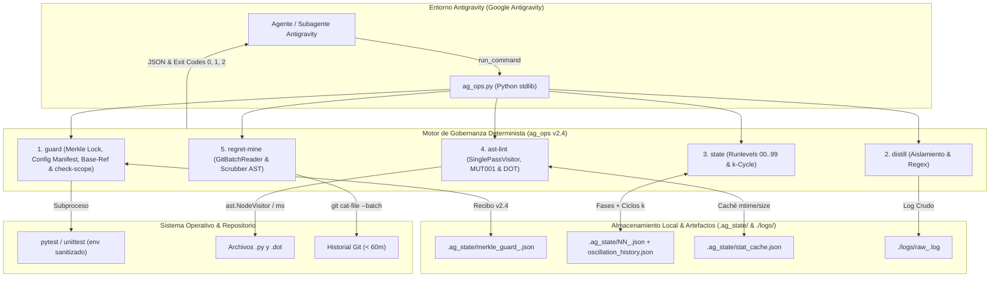

# CLI Engine for Agent Governance (`ag_ops` v2.4.0)

> **Creado por Francisco Grandón Vergara**  
> *Motor determinista en Python puro (librería estándar, sin dependencias externas) diseñado para la gobernanza estricta, trazabilidad criptográfica, linters estructurales y minería de regresión.*

[-blue.svg)](https://www.python.org/)
[](https://opensource.org/licenses/MIT)
[-brightgreen.svg)](#)
[](#)
[](#)
[-blueviolet.svg)](#)

---

## 1. Arquitectura Implementada en la Práctica

`ag_ops.py` es el arnés determinista de ejecución y control de integridad local para agentes autónomos. En lugar de confiar en instrucciones pasivas en los prompts, actúa como un **puente físico entre la ejecución del agente y la verificación de invariantes**: sellado de pruebas y configuración raíz, destilación de logs, bloqueo de pasos con detección de oscilación `k`-ciclo, validación estática AST en un único recorrido, separación de alcance Git y minería de arrepentimiento por lotes.

### 1.1 Diagrama de Flujo y Componentes Físicos en Ejecución



### 1.2 Invariantes de Ingeniería Implementadas
1. **Cero Dependencias Externas:** 100% biblioteca estándar de Python (`ast`, `configparser`, `hashlib`, `subprocess`, `json`, `pathlib`, `tempfile`, `tomllib` en Python 3.11+ con fallback en parser). Verificado mediante prueba AST automatizada sobre `sys.stdlib_module_names`.
2. **Escritura Atómica con Sincronización a Disco:** Todas las mutaciones de estado en `.ag_state/` usan archivos temporales con `os.replace` y `os.fsync`, previniendo corrupción de recibos ante cortes.
3. **Retrocompatibilidad de Esquema (`schema_version: "2.4"`):** Lee y verifica recibos históricos `v2.3` sin `schema_version`, agregando en `"2.4"` `root_config_manifest`, `env_policy`, `witnessed_test_count`, `base_ref` / `merge_base_sha` y `recent_tree_hashes` (`deque(maxlen=16)`).
4. **Contrato Estricto de Códigos de Salida:**
   - `0`: Operación exitosa / Invariantes íntegras.
   - `1`: Error de validación, sintaxis, conflicto de pasos o directorio vacío (`EMPTY_TEST_TARGET`).
   - `2`: **Violación Crítica de Seguridad o Integridad** (`EACCES_TEST_TAMPERING`, `ROOT_CONFIG_DRIFT`, `UNSAFE_PYTEST_ADDOPTS`, `ENV_TAINT_DETECTED`, `ZERO_TESTS_EXECUTED`, `TEST_COUNT_REGRESSION`, `SPEC_MODIFIED_SINCE_BASE`, `OSCILLATION_CYCLE_DETECTED`, `MIXED_SCOPE_VIOLATION`, `STRICT_PROBATIONARY`, `MUT001` bajo `--strict`).

---

## 2. Los Cinco Módulos Operativos (Implementación y Contratos)

### 2.1 `guard` — Bloqueo Merkle, Superficie Raíz, Alcance y Testigo Constructivo
Sella el árbol de pruebas mediante hashes SHA-256 (`hashlib.file_digest` + streaming de 64 KB con acarreo CRLF->LF en frontera) junto con la superficie de configuración raíz antes de que el agente altere el código de producción.

* **Aislamiento por Target y Sellado de Configuración Raíz (v2.4):**
  - Recibos unívocos: `.ag_state/merkle_guard_<sha256(normcase(target))[:12]>.json`.
  - **`root_config_manifest` (P0.1):** Sella `conftest.py`, `pytest.ini`, `pyproject.toml`, `setup.cfg`, `tox.ini`, `sitecustomize.py` y `usercustomize.py` desde `--test-dir` hasta la raíz del repositorio/workspace (incluyendo marcadores `ABSENT`); cualquier alta o edición tardía aborta con `ROOT_CONFIG_DRIFT` (`exit 2`).
  - **Inspección `addopts` y Sanitización de Entorno (P0.2–P0.3):** Bloquea flags evasivos (`--collect-only`, `--co`, filtros `-k`/`--ignore`/`--ignore-glob` no declarados en `--cmd`) y reglas personalizadas con `--forbid-addopts` (`UNSAFE_PYTEST_ADDOPTS`). Rechaza `PYTEST_ADDOPTS` y `PYTHONSTARTUP` (`ENV_TAINT_DETECTED`) salvo uso explícito y no relajable de `--allow-env-passthrough`.
  - **Conteo Efectivo de Pruebas (P0.4):** Registra `witnessed_test_count` en Rojo y rechaza `ZERO_TESTS_EXECUTED` o reducciones paramétricas (`TEST_COUNT_REGRESSION`, `exit 2`) en Verde.
* **Anclaje `--base-ref`, Detector `k`-Ciclo y Separación de Alcance (v2.4):**
  - **`--base-ref` / `merge-base` (P2.1):** Valida avance legítimo con `git merge-base --is-ancestor` y bloquea renegociaciones si las especificaciones citadas cambiaron respecto al `merge-base` (`SPEC_MODIFIED_SINCE_BASE`, `exit 2`). Registra `HEAD_MOVE_ALLOWED` si se usa `--allow-head-move`.
  - **Ciclos `k` (P2.2):** Detecta oscilaciones `A -> B -> ... -> A` (hasta `k = 16`) vía `recent_tree_hashes` (`OSCILLATION_CYCLE_DETECTED`, `exit 2`).
  - **`check-scope` (P2.3):** Ejecuta `git diff --name-only <base>...HEAD`; si un cambio mezcla rutas de `--rule-paths` con código productivo, aborta con `MIXED_SCOPE_VIOLATION` (`exit 2`).
  - **`renegotiate --batch` (P3.1):** Valida en rojo todos los objetivos de un manifiesto JSON bajo un único testigo constructivo `SCAR-PROC-150` (`batch_id`), con rollback atómico total ante cualquier objetivo en verde o testigo inválido (sin `--force`).

```powershell
# Registrar fallo inicial con sellado de configuración raíz y base-ref
python ag_ops.py guard witness-red --test-dir tests/ --cmd "pytest" --base-ref origin/main --json

# Verificar paso en verde sin manipulación de pruebas ni de configuración
python ag_ops.py guard verify-green --test-dir tests/ --json

# Auditar separación de alcance entre reglas/specs y código productivo
python ag_ops.py guard check-scope --base origin/main --rule-paths ".gemini/rules,ag_ops.py,.ag_state" --json

# Renegociación agrupada bajo un único testigo SCAR-PROC-150
python ag_ops.py guard renegotiate --batch batch_targets.json --reason "Actualización de contrato compartido" --witness-type spec-collision --conflict-a SPEC_A.md:12 --conflict-b SPEC_B.md:8 --json
```

### 2.2 `distill` — Destilación Determinista de Logs con Timeout
Ejecuta comandos de compilación o pruebas en subprocesos con aislamiento de grupo (`os.setsid` / `CREATE_NEW_PROCESS_GROUP`), guardando el registro completo en disco y entregando al agente únicamente el delta crítico.

* **Anclaje de Regex Estricto:** Expresiones regulares ancladas al inicio de línea (`^\s*E\s{3}`, `AssertionError`, trazas de compilador), neutralizando falsos positivos ante salidas largas.
* **Salida JSON:** Devuelve `exit_code`, `critical_delta` (o `tail` en éxito), `raw_log` y `duration_ms`.

```powershell
python ag_ops.py distill --cmd "pytest -v" --timeout 30 --json
```

### 2.3 `state` — Runlevels Lexicográficos y Detección de Deriva
Implementa persistencia de fases en disco (`.ag_state/NN_<slug>.json`) inspirada en los runlevels Unix (`00_governance` a `99_sintesis`), permitiendo al agente sobrevivir a la compactación de contexto y mantener una línea de tiempo determinista.

* **Trazabilidad de Artefactos:** Distingue entre archivos que nunca existieron (`ARTIFACT_NEVER_EXISTED`) y eliminaciones imprevistas (`FILE_DELETED`).
* **Detección de Oscilación `k`-Ciclo (v2.4):** Mantiene un historial acotado de hashes en `.ag_state/oscillation_history.json` (`maxlen=16`), abortando regresiones cíclicas `k >= 2` (o repeticiones idénticas sin `--replace`) con `OSCILLATION_CYCLE_DETECTED` (`exit 2`).
* **Sellado Automático:** Registra el hash SHA-256 de los artefactos producidos la primera vez que aparecen en el sistema de archivos.
* **Modo Estricto (`--strict`):** Sale con código 2 si se detecta cualquier alteración, borrado o artefacto tardío no sellado en escritura (`LATE_ARTIFACT_UNSEALED_AT_WRITE`).
* **Protección de Pasos:** Rechaza sobreescrituras accidentales del mismo paso (`STEP_CONFLICT`, `exit 1`), salvo uso de `--replace`.

```powershell
# Escribir fase
python ag_ops.py state write --dir .ag_state --step 1 --name "analisis" --status COMPLETADO --artifacts "docs/reporte.md" --replace --json

# Verificar deriva
python ag_ops.py state status --dir .ag_state --strict --json
```

### 2.4 `ast-lint` — `SinglePassVisitor`, Caché Incremental y Sensor `MUT001`
Inspecciona el código fuente sin ejecutarlo mediante `SinglePassVisitor` (tabla de despacho `_DEFAULT_LINT_DISPATCH` en un único recorrido AST por archivo) y caché incremental `.ag_state/stat_cache.json` por `(mtime_ns, size, sha256, ast_rules_hash)` con guardia anti-racy de 50 ms y protección ante retroceso de reloj (desactivable con `--no-cache` y deshabilitada en `--strict`).

* **Reglas de Integridad en Python:**
  - `TK001`: Prohíbe tamaños de fuente no enteros (flotantes) en tuplas Tkinter.
  - `TK002`: Prohíbe `background=` o `foreground=` directos en widgets `tkinter.ttk`.
  - `PATH001`: Prohíbe tragar excepciones (`except: pass`, `...`, `except Exception: continue` o `return {}`), emitiendo el campo **`reflex` (Vector 4)** con la acción correctiva concreta.
  - `PATH002`: Prohíbe importar `unittest.mock` en módulos de producción fuera de `tests/`.
  - `AUTH001`: Validación de cabecera obligatoria de autoría (configurable con `--author`).
  - `MUT001` *(v2.4)*: Detecta mutaciones ocultas sobre `self.<attr>` (`=`, `+=`, anotadas, `del`), sentencias `global` o `.append/.extend/.pop/.clear/.update` dentro de métodos de consulta (`get_*`, `is_*`, `has_*`, `validate_*`) sin descender a funciones/clases/lambdas internas. Emite advertencia por defecto (`warnings`) y bloquea bajo `--strict`; soporta supresión explícita auditable `# ag_ops: allow-mutation: <razón>`.
* **Protección contra Deriva Autoinmune y Modo `--strict` (H3):**
  - Con `--context-map`: Degrada reglas de `ENFORCED` a `PROBATIONARY_REVERIFY` cuando archivos ancla (`pyproject.toml`) cambian de hash.
  - Con `--strict`: Falla inmediatamente con `STRICT_PROBATIONARY` (`exit 2`) si algún hallazgo fue degradado por ancla modificada o borrada, y promueve `MUT001` a error bloqueante.
* **Validación Topológica Graphviz DOT (Target 15):** Valida que las máquinas de estado en `.dot` no tengan *deadlocks* (`DOT001`), no contengan nodos inalcanzables (`DOT002`), obliguen a transiciones explícitas y requieran guardas en aristas asíncronas (`SCAR-PROC-152`, `SCAR-ASYNC-01`).

```powershell
python ag_ops.py ast-lint . --author "Francisco Grandón Vergara" --include-dot --strict --json
```

### 2.5 `regret-mine` — Minería de Arrepentimiento Rápido por Lotes en Git
Audita el historial reciente del repositorio Git (`--window-min`, por defecto 60 minutos) identificando funciones en el árbol AST modificadas repetidamente en commits consecutivos mediante `GitBatchReader` (`git cat-file --batch`) y `git log --no-walk --stdin`.

* **Aislamiento `argv` e Inmunidad a Inyecciones (H2):** Todas las invocaciones internas a Git se ejecutan mediante listas de argumentos `argv` (`shell=False`), neutralizando ataques de inyección por nombres maliciosos en archivos o commits.
* **Soporte UTF-8 Completo:** Invocación de Git con `-c core.quotepath=false` para no escapar nombres con tildes (p. ej. `diseño.py`), garantizando su resolución sin errores de codificación.
* **Calificación Jerárquica y Scrubber AST Directo:** Mapeo de funciones como `ClassName.method` y normalización de literales `_StringLiteralScrubber` directo sobre clones AST (eliminando el costo de `ast.unparse`/`ast.parse`).
* **4 Puertas de Asimetría Deterministas:** Separa el TDD saludable (`Green -> Refactor`) de regresiones reales de código:
  1. `FIX_VERB_INTENT`: Presencia de verbos correctivos reales evaluados por `_FIX_VERB_RE` (`fix`, `bug`, `hotfix`, `revert`, `patch`, `typo` y variantes).
  2. `TEST_ASSERTION_DELTA`: Modificación simultánea de archivos de prueba junto con la función de producción en el commit posterior (`len(newer["test_files"]) > 0`).
  3. `LINE_REVERSAL_OVERLAP`: Inversión de líneas agregadas/borradas con guardas protectoras de refactorización limpia.
  4. `GUARD_COLLISION_RECEIPT`: Correlación con colisiones registradas en `.ag_state/`.

```powershell
python ag_ops.py regret-mine --repo . --window-min 60 --json
```

---

## 3. Modelo de Amenazas y Verificación Experimental

### 3.1 Fronteras de Confianza y Modelo de Amenazas
Para evitar sobrepromesas de seguridad dentro del mismo usuario/shell del agente, la arquitectura de gobernanza define tres adversarios (Descuidado, Reward Hacker, Hostil) y desacopla la autoridad del agente de la infraestructura que ejecuta las pruebas.

* Consultar el [Modelo de Amenazas Formal (`THREAT_MODEL.md`)](THREAT_MODEL.md).
* Consultar la [Especificación de Autoridad Fuera del Agente (`docs/ARCHITECTURE_V2_2_AUTHORITY.md`)](docs/ARCHITECTURE_V2_2_AUTHORITY.md).

### 3.2 Resultados de la Suite de Pruebas Automatizadas (`70` pytest + `11` unittest)
La arquitectura física de `ag_ops.py` v2.4 está respaldada por suites automatizadas de regresión, cobertura, compatibilidad v2.x, pruebas Git temporales y sensores P0–P3.

```powershell
# Ejecución completa de pytest, unittest de auditoría y compatibilidad sobre ag_ops.py
python -m pytest tests/ -v
python -m unittest test_ag_ops_v2.py
```

```text
tests/test_ag_ops.py              (9 passed)   — flujo base, 2-ciclo, --base-ref y check-scope
tests/test_ag_ops_qa_coverage.py  (25 passed)  — cobertura unitaria e integración CLI
tests/test_ag_ops_v2.py           (6 passed)   — regresión v2.0
tests/test_ag_ops_v2_1.py         (6 passed)   — regresión v2.1
tests/test_ag_ops_v2_2.py         (6 passed)   — regresión v2.2
tests/test_ag_ops_v2_4.py         (18 passed)  — cero dependencias + P0, P1, P2 y P3
test_ag_ops_v2.py (unittest)      (11 OK)      — suite raíz de auditoría
```

### 3.3 Benchmark Comparativo de Rendimiento (v2.3 vs. v2.4 — Mediana de 20 ejecuciones en Windows)

| Operación / Subcomando | v2.3 (mediana) | v2.4 (mediana) | Mejora |
| :--- | :---: | :---: | :---: |
| `ast-lint` archivo único frío (`--no-cache`) | 2.837 ms | 1.705 ms | **1.66x** |
| `ast-lint` archivo único caliente (`stat_cache.json`) | 2.744 ms | 1.266 ms | **2.17x** |
| `ast-lint` repositorio completo frío (`--no-cache`) | 240.813 ms | 171.552 ms | **1.40x** |
| `ast-lint` repositorio completo caliente (`stat_cache.json`) | 239.853 ms | 2.140 ms | **112.08x** |
| `guard verify-green` (suite 15 tests) | 206.677 ms | 11.573 ms | **17.86x** |
| `regret-mine` (12 commits, 3 módulos) | 7001.874 ms | 339.483 ms | **20.62x** |
| `state status --strict` | 1.594 ms | 1.026 ms | **1.55x** |

### 3.4 Benchmark Adversarial de Fallos de Agentes (36 Escenarios — `benchmark_agent_failures.py`)

Para evitar evaluar las garantías únicamente con pruebas unitarias favorables ("grading our own homework"), `benchmark_agent_failures.py` somete a `ag_ops.py` v2.4 a **36 escenarios adversariales** en 5 categorías (incluyendo los 6 vectores de evasión raíz `TAM-07`..`TAM-12` añadidos para v2.4):

1. **Alucinaciones (`HAL-01` .. `HAL-06`):** Fuentes flotantes en Tkinter, `background=` en ttk, grafos asíncronos `.dot` sin guardas, flags inexistentes en pytest, métodos inexistentes y deriva de esquemas.
2. **Manipulación de Pruebas (`TAM-01` .. `TAM-12`):** Edición directa de aserciones, `--ignore` discrepante, symlinks/junctions maliciosos, sustitución de `--cmd`, tests auto-mutantes, `conftest.py` / `pytest.ini` / `pyproject.toml` / `sitecustomize.py` fuera de `--test-dir`, `addopts = --collect-only`, `PYTEST_ADDOPTS=--collect-only` y salida silenciosa `os._exit(0)` con `0` tests ejecutados.
3. **Pérdida de Contexto (`CTX-01` .. `CTX-06`):** Tragado amplio de excepciones (`PATH001`), mocks en módulos productivos (`PATH002`), omisión de autoría (`AUTH001`), deriva y modo `--strict` de anclas y tuplas concretas de excepción.
4. **Falsas Justificaciones (`JUS-01` .. `JUS-06`):** Excusas en prosa sin testigo bajo `--require-witness`, archivos testigo fuera de Git, citas a comentarios/líneas vacías, falsas aserciones de `api-lock`, bifurcaciones inválidas y alibí sintáctico.
5. **Regresiones (`REG-01` .. `REG-06`):** Inversión de guardas, colisiones registradas, movimiento furtivo de `HEAD`, artefactos tardíos no sellados, filtro de literales de texto y compensación por indirección entre funciones.

#### Matriz Global de Resultados (`ag_ops.py` v2.4)

| Categoría de Fallo | Escenarios | Detectados | Escapes | Tasa de Detección | Latencia Media Medida | Subcomandos Evaluados |
| :--- | :---: | :---: | :---: | :---: | :---: | :--- |
| **1. Alucinaciones** | 6 | 4 | 2 | **66.7 %** | 38.86 ms | `ast-lint`, `guard witness-red` |
| **2. Manipulación de Pruebas** | 12 | 12 | 0 | **100.0 %** | 194.12 ms | `guard witness-red`, `guard verify-green` |
| **3. Pérdida de Contexto** | 6 | 5 | 1 | **83.3 %** | 4.42 ms | `ast-lint`, `state status --strict` |
| **4. Falsas Justificaciones** | 6 | 5 | 1 | **83.3 %** | 277.10 ms | `guard renegotiate` |
| **5. Regresiones** | 6 | 5 | 1 | **83.3 %** | 205.92 ms | `regret-mine`, `guard verify-green`, `state status --strict` |
| **TOTAL GLOBAL** | **36** | **31** | **5** | **86.11 %** | **—** | **Todos los subsistemas** |

```text
TASA DE DETECCIÓN VS. ESCAPE POR CATEGORÍA (ag_ops.py v2.4)
================================================================================
1. Alucinaciones          [████████████████░░░░░░░░]  4/6  Detectados (2 Escapes)
2. Manipulación Pruebas   [████████████████████████] 12/12 Detectados (0 Escapes)
3. Pérdida de Contexto    [████████████████████░░░░]  5/6  Detectados (1 Escape)
4. Falsas Justificaciones [████████████████████░░░░]  5/6  Detectados (1 Escape)
5. Regresiones            [████████████████████░░░░]  5/6  Detectados (1 Escape)
--------------------------------------------------------------------------------
TOTAL (36 Escenarios)     [█████████████████████░░░] 31/36 Detectados (86.11%)
================================================================================
```

#### Ejecución del Benchmark

```powershell
# Ejecutar suite adversarial sobre el motor local
python benchmark_agent_failures.py --ag-ops ./ag_ops.py
```

#### Los 5 Vectores de Escape Remanentes (Frontera Documentada Post-v2.4)

Con el cierre completo de los bypasses raíz de pruebas (`12/12` = `100.0 %` en *Manipulación de Pruebas*), los 5 escapes restantes corresponden a límites estructurales del análisis local de Nivel 2:

1. **`HAL-05` (`ESCAPE_UNRESOLVED_METHOD`):** Llamadas a métodos inexistentes fuera de cobertura AST sin chequeo de tipos dinámicos.
2. **`HAL-06` (`ESCAPE_SCHEMA_KEYS`):** Deriva semántica de claves en diccionarios o JSON sin validación en runtime.
3. **`CTX-06` (`ESCAPE_CONCRETE_EXCEPTION_TUPLE`):** Handlers acotados con tuplas explícitas de excepciones concretas (`except (ValueError, KeyError, TypeError): return None`), intencionalmente permitidos en v2.4 para evitar falsos positivos sobre parsers legítimos.
4. **`JUS-06` (`ESCAPE_SEMANTIC_NON_SEQUITUR`):** Alibí sintáctico en `spec-collision` citando dos líneas reales y no vacías de especificaciones confirmadas en Git que no se contradicen lógicamente.
5. **`REG-06` (`ESCAPE_CROSS_FUNCTION_INDIRECTION`):** Compensación de una regresión lógica mediante indirección entre funciones distintas no correlacionadas a nivel sintáctico local.

---

## 4. Fundamentos y Motivación Teórica: Por Qué Esta Arquitectura

La implementación de este motor no surge de la abstracción, sino de una **búsqueda y aprendizaje activo en el terreno** como usuario y desarrollador en el ecosistema **Antigravity (Google Antigravity)**.

### 4.1 La Trampa del Bucle Mortal de Prompts (*Quota vs. Prompt-Compliance Death Loop*)
En herramientas como Antigravity (y de forma análoga a lo que ocurre con `.cursorrules` o `CLAUDE.md`), intentar gobernar agentes mediante reglas puramente textuales genera un bucle destructivo:
* Al inyectar reglas negativas en prosa (`"NO tragues excepciones"`, `"NO alteres los tests"`), los tokens del antipatrón se incorporan al KV-cache del Transformer autorregresivo. La atracción por la instrucción negativa puede reforzar el comportamiento prohibido más que su prevención.
* El usuario humano reacciona discutiendo en el chat con diffs masivos (+50k tokens), añade más directivas al prompt de sistema y vacía la cuota de inferencia sin resolver la raíz del problema.

### 4.2 La Investigación de Randal L. Schwartz (*Synthetic Scars*)
Este motor traduce a código de producción los postulados de **Randal L. Schwartz** (Google Developer Expert) en su obra canónica [Giving AI Pain: The Architecture of Synthetic Scars & The Rapid Regret Loop](https://www.randallischwartz.com/).

* **El Fracaso de la *Bitter Lesson* en Código:** Escalar el cómputo de inferencia (*test-time compute*) sin restricciones físicas hace que el agente construya una **"Catedral sobre Arenas Movedizas"**: más consumo de tokens, menos predictibilidad y más posibilidad de seguir caminos no integrados.
* **Invariantes de Camino ($I_{\text{path}}(\pi)$):** Más del 95% de los fallos graves no violan el objetivo del ticket ($I_{\text{goal}}$), sino las obligaciones secundarias derivadas de la ruta del código.
* **Dolor Sintético:** Sustituir advertencias de texto por fricción mecánica real (Merkle trees, AST linters con Vector 4 de reflejo, runlevels en disco y minería de arrepentimiento).

### 4.3 Reducción Empírica de Contexto
En mi publicación [I cut my agents' fixed context by 42% and moved its test rules into a hash-checked CLI](https://dev.to/fgrandon/i-cut-my-agents-fixed-context-by-42-and-moved-its-test-rules-into-a-hash-checked-cli) se documenta la reducción de contexto y el paso de un sistema basado en prompts a un diseño con invariantes ejecutadas fuera del agente.

---

## 5. Estructura del Repositorio

```text
CLI Engine for Agent Governance/
├── ag_ops.py                    # Motor CLI determinista ejecutable (v2.4.0)
├── ag_ops_v2.py                 # Motor CLI de referencia histórico y compatibilidad v2.2
├── benchmark_agent_failures.py  # Suite de benchmark adversarial experimental (36 escenarios, 5 categorías)
├── pyproject.toml               # Configuración de calidad (ruff, mypy)
├── CHANGELOG.md                 # Registro histórico de versiones y aprendizajes
├── README.md                    # Documentación técnica, arquitectura y guía
├── THREAT_MODEL.md              # Modelo de amenazas formal (3 adversarios, 3 garantías)
├── test_ag_ops_v2.py            # Suite raíz de auditoría de defectos e invariantes
├── tests/
│   ├── test_ag_ops.py           # Suite de integración v2.1 + P2 (oscilación, base-ref, check-scope)
│   ├── test_ag_ops_qa_coverage.py  # Suite de cobertura exhaustiva de helpers y ramas CLI
│   ├── test_ag_ops_v2.py        # Suite automatizada de regresión v2.0
│   ├── test_ag_ops_v2_1.py      # Suite integral de verificación v2.1
│   ├── test_ag_ops_v2_2.py      # Suite TDD de endurecimiento de fronteras v2.2
│   └── test_ag_ops_v2_4.py      # Suite de verificación v2.4 (cero dependencias + P0, P1, P2, P3)
├── docs/
│   ├── ARCHITECTURE_V2_2_AUTHORITY.md                               # Autoridad fuera del agente y anclaje CI
│   ├── INFORME_PRUEBAS_ag_ops_v2.md                                 # Hallazgos empíricos y análisis de latencia
│   ├── CHANGELOG - ag_ops.py.txt                                    # Notas de diseño e iteraciones de la v2.1
│   └── Matriz de verificacion - test autonomo y re-medidcion - ag_ops.py.txt  # Matriz de especificación
└── LICENSE                      # MIT License
```

---

## 6. Próximos Pasos en el Laboratorio

1. **Ejecución en Sidecar Efímero sin Privilegios (v3.0):** Desacoplar la ejecución de verificación bajo un usuario o namespace aislado del sistema operativo para blindar físicamente `.ag_state/` contra agentes con UID compartido.
2. **Acción GitHub de Verificación Desacoplada (`ag-ops-verify-action`):** Implementación de referencia oficial de Tier 3 para CI que audita recibos v2.4 y verifica `guard check-scope` y testigos firmados sin confianza en el entorno local del agente.
3. **Grafo de Llamadas Inter-Función en `regret-mine` y Tipado Estático Integrado:** Explorar análisis de callees para contener indirecciones `REG-06` e integración opcional de reporte para `HAL-05`/`HAL-06` manteniendo la frontera 100% stdlib del motor base.

---

## 7. Licencia y Créditos

* Licencia: [MIT License](LICENSE)
* Marco teórico y arquitectura conceptual de Synthetic Scars: **Randal L. Schwartz** (Google Developer Expert).
* Arquitectura técnica implementada, desarrollo en Python y experimentación en Antigravity: **Francisco Grandón Vergara**.
