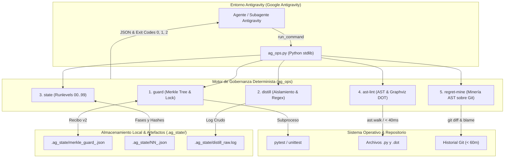

# CLI Engine for Agent Governance (`ag_ops` v2.1.0)

> **Creado por Francisco Grandón Vergara**  
> *Motor determinista en Python puro (librería estándar, sin dependencias externas) diseñado para la gobernanza estricta, trazabilidad criptográfica, linters estructurales y minería de regresiones en agentes autónomos dentro del ecosistema Antigravity.*

[](https://www.python.org/)
[](https://opensource.org/licenses/MIT)
[-brightgreen.svg)](#)
[](#)
[-success.svg)](#)

---

## 1. Arquitectura Implementada en la Práctica

`ag_ops.py` es un arnés determinista de ejecución y control de integridad local para agentes autónomos. En lugar de confiar en instrucciones pasivas en los prompts, actúa como un **puente físico intermedio** entre el agente de Antigravity, el sistema de archivos del proyecto, el motor de pruebas y el repositorio Git.

### 1.1 Diagrama de Flujo y Componentes Físicos en Ejecución



### 1.2 Invariantes de Ingeniería Implementadas
1. **Cero Dependencias Externas:** 100% biblioteca estándar de Python (`ast`, `hashlib`, `subprocess`, `json`, `pathlib`, `tempfile`). No requiere `pip install`, funcionando instantáneamente en Windows y Linux.
2. **Escritura Atómica con Sincronización a Disco:** Todas las mutaciones de estado en `.ag_state/` usan archivos temporales con `os.replace` y `os.fsync`, previniendo corrupción de recibos ante interrupciones forzadas.
3. **Contrato Estricto de Códigos de Salida:**
   - `0`: Operación exitosa / Invariantes íntegras.
   - `1`: Error de validación, sintaxis, conflicto de pasos o directorio vacío (`EMPTY_TEST_TARGET`).
   - `2`: **Violación Crítica de Seguridad o Integridad** (sabotaje de tests `EACCES_TEST_TAMPERING`, corrupción de recibos `CORRUPTED_RECEIPT` o deriva de artefactos `has_drift` en modo `--strict`).

---

## 2. Los Cinco Módulos Operativos (Implementación y Contratos)

### 2.1 `guard` — Bloqueo Merkle de Tests y Testigo Constructivo
Sella el árbol de pruebas mediante hashes SHA-256 antes de que el agente altere el código de producción, impidiendo trampas o modificaciones no autorizadas en los tests.

* **Aislamiento por Target:** Los recibos se nombran de forma unívoca según el objetivo:  
  `.ag_state/merkle_guard_<sha256(normcase(target))[:12]>.json`.
* **Subcomandos:**
  - `witness-red`: Ejecuta la suite de pruebas esperada en fallo inicial. Valida códigos de aserción (rechaza anomalías de entorno como 2, 3, 4, 5, 126, 127, 9009), genera el árbol Merkle de los archivos de prueba y emite el recibo v2.
  - `verify-green`: Reejecuta los tests tras el arreglo. Si algún archivo de prueba fue editado o borrado, aborta con `EACCES_TEST_TAMPERING` (`exit 2`) y registra la colisión en vuelo en el recibo.
  - `renegotiate`: Permite modificar los tests únicamente ante una prueba formal en disco (**SCAR-PROC-150**). Con `--require-witness`, rechaza excusas textuales (`LAZY_RETRACTION_REJECTED`) y exige `--witness-type spec-collision` (con `--conflict-a` y `--conflict-b` en `archivo:línea` reales), `api-lock` o `arch-fork`.

```powershell
# Registrar fallo inicial y sellar tests
python ag_ops.py guard witness-red --test-dir tests/ --cmd "pytest" --json

# Verificar paso en verde sin manipulación de pruebas
python ag_ops.py guard verify-green --test-dir tests/ --json
```

### 2.2 `distill` — Destilación Determinista de Logs con Timeout
Ejecuta comandos de compilación o pruebas en subprocesos con aislamiento de grupo (`os.setsid` / `CREATE_NEW_PROCESS_GROUP`), guardando el registro completo en disco y entregando al agente únicamente el delta crítico estructurado.

* **Anclaje de Regex Estricto:** Expresiones regulares ancladas al inicio de línea (`^\s*E\s{3}`, `AssertionError`, trazas y diagnósticos de compilador), neutralizando falsos positivos ante salidas como `"DONE   all good"`.
* **Salida JSON:** Devuelve `exit_code`, `critical_delta`, `raw_log_path` y `duration_ms`.

```powershell
python ag_ops.py distill --cmd "pytest -v" --timeout-sec 30 --json
```

### 2.3 `state` — Runlevels Lexicográficos y Detección de Deriva
Implementa persistencia de fases en disco (`.ag_state/NN_<slug>.json`) inspirada en los runlevels Unix (`00_governance` a `99_sintesis`), permitiendo al agente sobrevivir a la compactación de contexto (*200k-token lobotomy*).

* **Trazabilidad de Artefactos:** Distingue entre archivos que nunca existieron (`ARTIFACT_NEVER_EXISTED`) y eliminaciones imprevistas (`FILE_DELETED`).
* **Sellado Automático:** Registra el hash SHA-256 de los artefactos producidos la primera vez que aparecen en el sistema de archivos.
* **Modo Estricto (`--strict`):** Sale con código 2 si se detecta cualquier alteración o borrado de artefactos previamente sellados.
* **Protección de Pasos:** Rechaza sobreescrituras accidentales del mismo paso (`STEP_CONFLICT`, `exit 1`), salvo uso de `--replace`.

```powershell
# Escribir fase
python ag_ops.py state write --step 1 --name "analisis" --status COMPLETADO --artifacts "docs/reporte.md" --replace --json

# Verificar deriva
python ag_ops.py state status --strict --json
```

### 2.4 `ast-lint` — Linter Estático AST (< 40 ms) y Validación Graphviz DOT
Inspecciona el código fuente sin ejecutarlo, previniendo errores arquitectónicos antes de correr suites pesadas.

* **Reglas de Integridad en Python:**
  - `TK001`: Prohíbe tamaños de fuente no enteros (flotantes) en tuplas Tkinter.
  - `TK002`: Prohíbe `background=` o `foreground=` directos en widgets `tkinter.ttk`.
  - `PATH001`: Prohíbe tragar excepciones (`except: pass` o `...`), emitiendo el campo **`reflex` (Vector 4)** con la acción correctiva concreta.
  - `PATH002`: Prohíbe importar `unittest.mock` en módulos de producción fuera de `tests/`.
  - `AUTH001`: Validación de cabecera obligatoria de autoría (configurable con `--author`).
* **Protección contra Deriva Autoinmune (`--context-map`):** Degrada reglas de `ENFORCED` a `PROBATIONARY_REVERIFY` cuando archivos ancla (`pyproject.toml`, `requirements.txt`) cambian de hash.
* **Validación Topológica Graphviz DOT (Target 15):** Valida que las máquinas de estado en `.dot` no tengan *deadlocks* (`DOT001`), no contengan nodos inalcanzables (`DOT002`), obliguen a transiciones de salida o cancelación en estados asíncronos (`SCAR-PROC-152`) y posean predicados `[guard: ...]` contra callbacks zombis (`SCAR-ASYNC-01`).

```powershell
python ag_ops.py ast-lint . --author "Francisco Grandón Vergara" --include-dot --json
```

### 2.5 `regret-mine` — Minería de Arrepentimiento Rápido en Git
Audita el historial reciente del repositorio Git (`--window-min`, por defecto 60 minutos) identificando funciones en el árbol AST modificadas repetidamente en commits consecutivos.

* **4 Puertas de Asimetría Deterministas:** Separa el TDD saludable (`Green -> Refactor`) de regresiones reales de código:
  1. `FIX_VERB_INTENT`: Presencia de verbos correctivos (`fix:`, `patch:`, `repair:`).
  2. `TEST_ASSERTION_DELTA`: Disminución o salto anómalo en el conteo de aserciones de prueba.
  3. `LINE_REVERSAL_OVERLAP`: Inversión de líneas agregadas/borradas con guardas protectoras de refactorización limpia.
  4. `GUARD_COLLISION_RECEIPT`: Correlación con colisiones registradas en `.ag_state/`.

```powershell
python ag_ops.py regret-mine --repo . --window-min 60 --json
```

---

## 3. Verificación Experimental: Resultados de la Suite de Pruebas

La arquitectura física de `ag_ops.py` está respaldada por una suite automatizada de pruebas de regresión e integración que cubre el 100% de los 6 bloques funcionales:

```powershell
# Ejecución de la suite completa
python tests\test_ag_ops.py
```

### Resultados de Ejecución en Laboratorio:
```text
test_01_guard_receipt_isolation_and_empty_dir (__main__.TestAgOps.test_01_guard_receipt_isolation_and_empty_dir) ... ok
test_02_guard_strict_exclusions_and_constructive_witness (__main__.TestAgOps.test_02_guard_strict_exclusions_and_constructive_witness) ... ok
test_03_distill_regex_anchor (__main__.TestAgOps.test_03_distill_regex_anchor) ... ok
test_04_state_lifecycle_and_strict (__main__.TestAgOps.test_04_state_lifecycle_and_strict) ... ok
test_05_ast_lint_tk002_author_paths_context_and_dot (__main__.TestAgOps.test_05_ast_lint_tk002_author_paths_context_and_dot) ... ok
test_06_regret_mine (__main__.TestAgOps.test_06_regret_mine) ... ok

----------------------------------------------------------------------
Ran 6 tests in ~5.0s

OK (100% aprobado)
```

---

## 4. Fundamentos y Motivación Teórica: Por Qué Esta Arquitectura

La implementación de este motor no surge de la abstracción, sino de una **búsqueda y aprendizaje activo en el terreno** como usuario y desarrollador en el ecosistema **Antigravity (Google Antigravity)**.

### 4.1 La Trampa del Bucle Mortal de Prompts (*Quota vs. Prompt-Compliance Death Loop*)
En herramientas como Antigravity (y de forma análoga a lo que ocurre en la industria con `.cursorrules` o `CLAUDE.md`), intentar gobernar agentes mediante reglas puramente textuales genera un bucle destructivo:
* Al inyectar reglas negativas en prosa (*"NO tragues excepciones"*, *"NO alteres los tests"*), los tokens del antipatrón se incorporan al KV-cache del Transformer autorregresivo. La atracción estadística de tutoriales de internet termina disparando el comportamiento prohibido (efecto del "elefante rosa").
* El usuario humano reacciona discutiendo en el chat con diffs masivos (+50k tokens), añade más directivas al prompt de sistema y vacía la cuota de inferencia sin resolver la raíz del problema.

### 4.2 La Investigación de Randal L. Schwartz (*Synthetic Scars*)
Este motor traduce a código de producción los postulados de **Randal L. Schwartz** (Google Developer Expert) en su obra canónica [Giving AI Pain: The Architecture of Synthetic Scars & The Rapid-Regret Miner](https://dev.to/gde/giving-ai-pain-the-architecture-of-synthetic-scars-the-rapid-regret-miner-1740):
* **El Fracaso de la *Bitter Lesson* en Código:** Escalar el cómputo de inferencia (*test-time compute*) sin restricciones físicas hace que el agente construya una **"Catedral sobre Arenas Movedizas"** (*Cathedral on Quicksand*): cientos de líneas de adaptadores y mocks tautológicos diseñados solo para pintar el test de verde mientras corrompen la arquitectura.
* **Invariantes de Camino ($I_{\text{path}}(\pi)$):** Más del 95% de los fallos graves no violan el objetivo del ticket ($I_{\text{goal}}$), sino las obligaciones secundarias derivadas de la ruta de implementación (liberación de recursos, ausencia de mocks en producción, respeto a cabeceras).
* **Dolor Sintético:** Sustituir advertencias de texto por fricción mecánica real (Merkle trees, AST linters con Vector 4 de reflejo, runlevels en disco y minería de arrepentimiento).

### 4.3 Reducción Empírica de Contexto
En mi publicación [I cut my agents' fixed context by 42% and moved its test rules into a hash-checked CLI](https://dev.to/fgrandon/i-cut-my-agents-fixed-context-by-42-and-moved-its-test-rules-into-a-hash-checked-cli-5dmp) demostré que externalizar estas reglas del prompt hacia un CLI determinista reduce en un 42% la sobrecarga de tokens fijos, liberando atención del modelo para la tarea real.

---

## 5. Estructura del Repositorio

```text
ag-ops/
├── ag_ops.py                    # Motor CLI determinista ejecutable (v2.1.0)
├── CHANGELOG.md                 # Registro histórico de versiones y cambios (Keep a Changelog)
├── LICENSE                      # Licencia MIT
├── README.md                    # Documentación técnica, arquitectura y guía
└── tests/
    └── test_ag_ops.py           # Suite integral de verificación automatizada (6/6 bloques)
```

---

## 6. Próximos Pasos en el Laboratorio

1. **Aislamiento de Permisos a Nivel de Sistema Operativo:** Diseñar mecanismos para que el directorio de recibos `.ag_state/` resida fuera del alcance de escritura directa del agente, blindando la contención física.
2. **Optimización de Latencia en AST:** Reducir la latencia de `ast-lint` a menos de 15 ms por archivo en bases de código masivas.
3. **Calibración Fina de `regret-mine`:** Ajustar heurísticas de commits de documentación y formato en repositorios con cientos de ramas concurrentes.

---

## 7. Licencia y Créditos

* Licencia: [MIT License](LICENSE)
* Marco teórico y arquitectura conceptual de Synthetic Scars: **Randal L. Schwartz** (Google Developer Expert).
* Arquitectura técnica implementada, desarrollo en Python y experimentación en Antigravity: **Francisco Grandón Vergara**.
